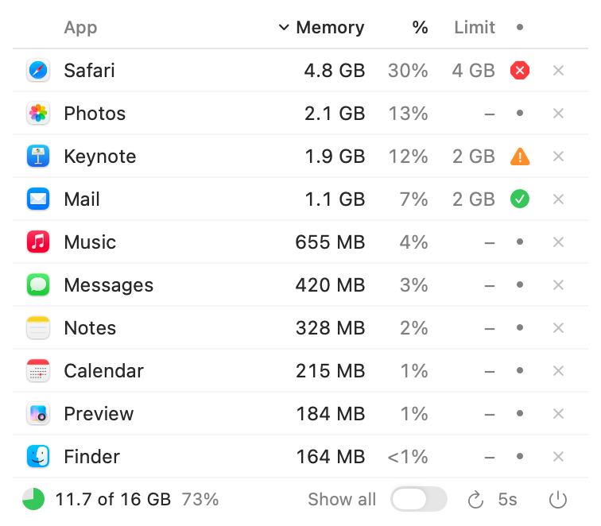
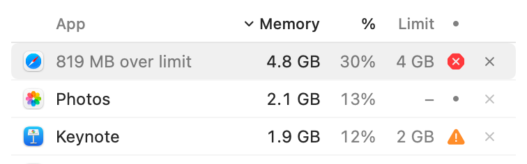

<p align="center">
  
</p>

<h1 align="center">Mindshare</h1>

<p align="center">
  See which apps are using your Mac's memory, get warned when one uses too much, and quit it in one click.
</p>

<p align="center">
  <a href="https://github.com/PierrepontAdvisors/Mindshare/releases/latest/download/Mindshare.zip"><strong>Download Mindshare</strong></a>
  &nbsp;·&nbsp; macOS 14 or later &nbsp;·&nbsp; Free and open source
</p>

<p align="center">
  <picture>
    <source media="(prefers-color-scheme: dark)" srcset="screenshots/panel-dark.png">
    
  </picture>
</p>

<p align="center"><sub>Screenshots in this guide use sample data.</sub></p>

## What it does

When your Mac slows down, memory is often the reason, but it's hard to tell which app is responsible. Mindshare sits quietly in your menu bar and answers that at a glance.

- **See real totals.** Modern apps run as many hidden helper processes. Mindshare adds them together, so you see what each app actually uses.
- **Know when to act.** A small icon in the menu bar tells you if things are OK, without opening anything.
- **Set limits.** Choose a limit for any app and get a notification if it goes over.
- **Quit in one click.** Apps can still ask you to save your work first.
- **Stay light.** It uses about 16 MB of memory and under 1% of your CPU while the panel is closed, measured on an Apple M4 Mac.

## Install

1. [Download `Mindshare.zip`](https://github.com/PierrepontAdvisors/Mindshare/releases/latest/download/Mindshare.zip).
2. Open the zip, then drag **Mindshare** into your **Applications** folder.
3. Open Mindshare. macOS will say it can't verify the app. Close that message.
4. Open **System Settings > Privacy & Security**, scroll down, and click **Open Anyway** next to Mindshare.
5. Choose **Allow** when asked about notifications, so limit warnings can reach you.

Mindshare lives in the menu bar at the top of your screen, not in the Dock. Look for a small green pie.

**Why the warning?** Apple charges developers a yearly fee to sign apps, and Mindshare isn't signed that way. You only need to approve it once. To confirm your download is genuine, compare it with the fingerprint on the [release page](https://github.com/PierrepontAdvisors/Mindshare/releases/latest).

**Intel Macs:** the download includes an Intel version, but it hasn't been tested on an Intel Mac yet. If you try it, please [tell us how it goes](https://github.com/PierrepontAdvisors/Mindshare/issues).

## The menu bar icon

| Icon | What it means | What to do |
|:---:|---|---|
|  | All fine. The filled part shows how much memory is in use. | Nothing |
|  | Memory is getting tight, or an app has gone over its limit. | Open the panel and take a look |
|  | Your Mac is critically short of memory. | Quit something large |

Click the icon to open the panel, and click it again to close it.

## Reading the panel

Each row is one app, with all of its helper processes added together.

| Column | What it shows |
|---|---|
| **App** | The app's name and icon. Grey names are background processes you can't quit. |
| **Memory** | How much memory the app is using right now. |
| **%** | That app's share of your Mac's total memory. |
| **Limit** | The limit you've set, or a dash if there isn't one. Click it to change it. |
| **Status** | How the app is doing against its limit, explained below. |
| **×** | Quits the app. |

**Click any column heading to sort** by it, and click again to reverse the order.

| Status | Meaning |
|---|---|
| Small dot | No limit set |
| Green check | Under its limit |
| Amber triangle | Within 10% of its limit |
| Red octagon | Over its limit |

## Hover for more detail

Hover over almost anything to learn more. The app's name is briefly replaced with the detail, so it appears right where you're looking.

<p align="center">
  <picture>
    <source media="(prefers-color-scheme: dark)" srcset="screenshots/hover-dark.png">
    
  </picture>
</p>

| Hover over | You'll see |
|---|---|
| An app's icon | How many processes it's running |
| Memory | The highest it has reached so far |
| % | Its share of your total memory |
| Limit | How to set or change the limit |
| Status | How far it is over or under its limit |
| × | How to quit, or force quit |

## Setting a limit

1. Click the dash or number in an app's **Limit** column.
2. Pick a limit from 1 GB to 12 GB, or **No limit**.

If the app goes over, you get one notification and the menu bar icon turns amber. You won't be warned again unless it drops well below the limit and climbs back over.

**A limit is a warning, not a cap.** macOS has no supported way to stop an app from using memory, so Mindshare tells you and leaves the decision to you. It never quits anything by itself.

## Quitting an app

- **Click the ×** for a normal quit. The app can ask you to save your work first.
- **Hold Option and click the ×** to force quit an app that's frozen.

> [!WARNING]
> Force quit closes the app immediately, and anything unsaved is lost.

## The footer

The bottom line of the panel covers your whole Mac.

- **Pie and total:** how much memory is in use. Green means normal, amber means elevated and red means critical, based on the memory pressure macOS reports. Hover over the pie for a full breakdown:

  <picture>
    <source media="(prefers-color-scheme: dark)" srcset="screenshots/breakdown-dark.png">
    
  </picture>

- **Show all:** off by default, which lists apps you can quit that use at least 20 MB, plus anything you've set a limit on. Turn it on to add smaller apps and background processes over 100 MB.
- **Refresh menu (`5s`):** how often Mindshare checks memory, from every second to every minute. Longer uses less energy. This is also where you turn on **Open at login**, so Mindshare starts by itself and keeps watching after a restart.
- **Orange bell:** notifications are off. Click it to open the right page in System Settings.
- **Power button:** quits Mindshare.

## Your privacy

Everything stays on your Mac. Mindshare has no account, no analytics, and makes no network connections.

It reads app names and memory figures so it can show them to you, and saves your limits and settings on your Mac. The only permission it asks for is notifications.

## Troubleshooting

**I can't see the icon.** Your menu bar may be full, especially on a MacBook with a notch. Quit another menu bar app to make room.

**I'm not getting warnings.** Look for the orange bell in the footer, or go to **System Settings > Notifications > Mindshare** and turn on **Allow Notifications**.

**An app isn't in the list.** Turn on **Show all**. Small helper apps are hidden by default.

**An app won't quit.** It may be frozen, or waiting for you to save. Check its window, then hold Option and click the × if you need to.

**The numbers differ from Activity Monitor.** Mindshare uses the same measure, but adds each app's helper processes together, so its totals are usually higher than any single row there.

## Uninstall

1. If you turned on **Open at login**, turn it off in the refresh menu.
2. Click the power button in the panel to quit Mindshare.
3. Drag **Mindshare** from Applications to the Trash.

To remove your saved settings too, run this in Terminal:

```bash
defaults delete com.pierrepontadvisors.mindshare
```

## For developers

Mindshare is written in Swift and SwiftUI, with no third-party dependencies. You only need Apple's Command Line Tools, not full Xcode.

```bash
xcode-select --install
git clone https://github.com/PierrepontAdvisors/Mindshare.git
cd Mindshare
./build-app.sh
```

This runs the logic checks and creates `build/Mindshare.app` and `build/Mindshare.zip`. To run only the checks, use `swift run CoreCheck`.

| Path | What's there |
|---|---|
| `Sources/MemoryCore` | Logic with no interface: grouping, limits, sorting and formatting |
| `Sources/Mindshare` | The menu bar app and its views |
| `Sources/CoreCheck` | The logic checks |
| `Scripts/make-icons.swift` | Draws the app icon |

Grouping helper processes under their app uses a private macOS function. If a future macOS removes it, helpers appear as background processes instead.

## License

MIT. See [LICENSE](LICENSE). Mindshare isn't affiliated with Apple, and the Apple apps in the screenshots are shown only as sample data.
